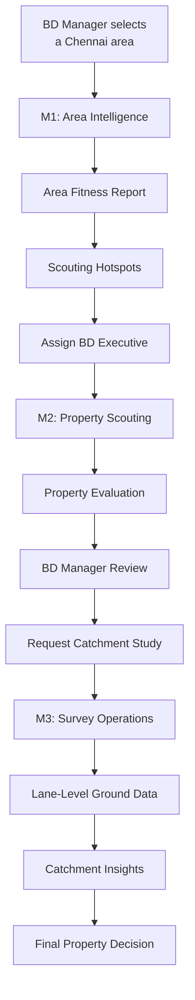
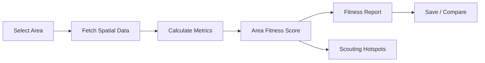
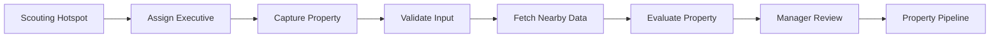
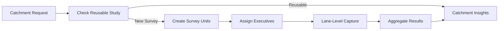
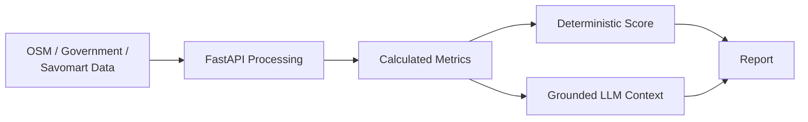
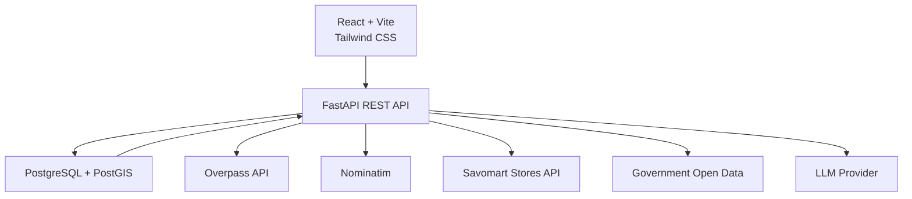

# Savo SiteScout

A data-driven store expansion and field-survey platform for Savomart's Chennai operations.

## Project Overview

Savo SiteScout is the full-stack application I am building to make Savomart's store expansion process more structured and data-driven.

Instead of starting the expansion process only after a field executive happens to discover a property, the platform starts by analysing an area digitally. A BD Manager can study a Chennai locality, understand the surrounding commercial and residential signals, identify promising scouting pockets, and then send executives to locations that are already worth investigating.

When a property is discovered, the same platform is used to capture its details, evaluate the surrounding location, move it through the decision process, and request a ground-level catchment survey when more evidence is required.

The project therefore connects three stages that would otherwise be separate:

**Area Intelligence → Property Scouting & Evaluation → Catchment Validation**

---

# What I Am Building

The application has four role-based experiences:

- **BD Manager** — analyses areas, creates scouting work, reviews properties and requests catchment studies.
- **BD Executive** — receives scouting assignments and captures candidate properties from the field.
- **Survey Manager** — converts catchment requests into manageable survey assignments.
- **Survey Executive** — performs lane-level surveys and submits ground observations.

For the hackathon version, I will use seeded demo users with a role switcher. This keeps the implementation focused on the expansion workflow instead of spending significant time on authentication.

---

# Core Application Flow



---

# Module 1 — Area Intelligence

## Goal

The first module helps the BD Manager answer:

> **Which part of Chennai should the team investigate before sending someone there?**

The manager starts from an interactive Chennai map and selects an area using a locality, pincode, or map/grid selection.

## Area Analysis

Once an area is selected, the backend collects useful location signals from available public datasets and Savomart's operational-store data.

I will use signals such as:

- Residential presence
- Nearby shops and businesses
- Schools, hospitals and other amenities
- Road accessibility
- Public transport points
- Grocery and supermarket competition
- Distance from existing Savomart stores

These signals are converted into an explainable **Area Fitness Score**.

## Area Fitness Score

I will calculate the score in backend code instead of asking an LLM to decide whether an area is good.

An initial scoring model will use weighted signals such as:

| Signal                               | Initial Weight |
| ------------------------------------ | -------------: |
| Residential potential                |            25% |
| Commercial / demand indicators       |            20% |
| Amenities                            |            15% |
| Road accessibility                   |            15% |
| Transit accessibility                |            10% |
| Competition                          |            10% |
| Savomart proximity / cannibalisation |             5% |

These weights are an implementation choice for the MVP and can be tuned after testing different Chennai localities.

The report will show the component values behind the final score so that the result is understandable rather than appearing as a black-box rating.

## Area Fitness Report

For every completed analysis, I will save:

- Selected area
- Overall fitness score
- Score breakdown
- Important positive signals
- Important risks
- Nearby competition
- Existing Savomart proximity
- Recommended scouting hotspots
- Analysis timestamp
- Data-source metadata

Managers will be able to reopen old reports and compare previously analysed areas.

## Scouting Hotspots

Instead of stopping at an area-level score, I will identify promising pockets inside the selected area.

For the MVP, the area can be divided into smaller map cells. Each cell can be evaluated using nearby residential, commercial, accessibility and competition signals.

The strongest cells become suggested scouting hotspots.

This gives the BD Manager a practical next action rather than only showing an area score.

## M1 Flow



---

# Module 2 — Property Scouting and Evaluation

## Goal

The second module turns a promising area into actual candidate properties.

The BD Manager can create a scouting assignment from an analysed area or one of its suggested hotspots.

The assigned BD Executive sees that task from a mobile-friendly interface.

## Scouting Assignment

A scouting task will contain:

- Target area / hotspot
- Assigned executive
- Map location
- Manager instructions
- Assignment status

This connects the recommendation generated in M1 directly to field work.

## Property Capture

When the executive finds a possible store location, they can create a property record from their phone.

I plan to capture:

- GPS / map location
- Address
- Monthly rent
- Property area
- Frontage
- Road width
- Parking / loading access
- Visibility
- Property condition
- Notes
- Property photos

The form will validate required and numeric fields before submission.

## Duplicate and Location Validation

Before creating a property, the backend will check for nearby existing candidate properties.

PostGIS distance queries can be used to warn the executive when another property already exists very close to the selected location.

The map will also make the captured pin visible so that obviously incorrect coordinates can be corrected before submission.

## Automatic Property Evaluation

After submission, the property is evaluated using two types of information.

### Field Signals

- Rent
- Size
- Frontage
- Road width
- Parking/access
- Visibility
- Condition

### Location Signals

- Surrounding residential activity
- Nearby amenities
- Nearby businesses
- Competitors
- Road/accessibility information
- Distance from existing Savomart stores

The evaluation will produce:

- Property score
- Main strengths
- Main risks
- Recommendation

The score will remain deterministic and explainable in the same way as the M1 score.

## Property Decision Pipeline

I will use the following initial workflow:

```text
SCOUTED
   ↓
UNDER REVIEW
   ↓
CATCHMENT REQUESTED
   ↓
CATCHMENT COMPLETE
   ↓
APPROVED / REJECTED
```

The BD Manager can move a property through these stages.

Each transition creates an activity-history record containing:

- User
- Previous stage
- New stage
- Timestamp
- Reason / note

This gives the property a complete decision trail.

## M2 Flow



---

# Module 3 — Catchment Study and Survey Operations

## Goal

The third module adds real field evidence when virtual analysis and property information are not enough to make the decision.

A BD Manager can request a catchment study against either:

- A candidate property
- An analysed area

The request then moves to the Survey Manager.

## Survey Planning

The Survey Manager receives pending catchment requests and converts them into smaller survey assignments.

For the MVP, I will represent the catchment as a geographic area around the target and divide it into smaller non-overlapping work units.

Each unit will have:

- Geographic boundary
- Assigned Survey Executive
- Status
- Progress

This allows several executives to work on the same catchment without intentionally surveying the same section.

## Lane-Level Survey

The Survey Executive will use a mobile-friendly form to record observations while walking through the assigned area.

The initial survey will capture:

- Lane / location
- Residential presence
- Shops and businesses
- Grocery competitors
- Road characteristics
- Approximate footfall / traffic band
- Notes

The goal is not to collect every possible field, but to capture information that can improve the store-location decision.

## Weak Network Handling

Because survey executives may work in areas with unreliable connectivity, I will preserve partially completed forms locally in the browser.

A draft can be restored and submitted when connectivity becomes available again.

For the MVP, this can be implemented using browser local storage rather than building a complex offline synchronisation system.

## Survey Progress

The Survey Manager and BD Manager will be able to see:

- Total assignments
- Pending assignments
- In-progress assignments
- Completed assignments
- Overall completion percentage

## Catchment Insights

After the survey is completed, the backend aggregates the submitted observations.

The resulting catchment summary is linked back to the original property or analysed area.

The BD Manager can then review:

**Virtual Area Data + Property Data + Ground Survey Data**

before making the next property decision.

## Catchment Reuse

Before creating a new survey, the backend will check for an existing catchment study nearby.

I will use two conditions for the MVP:

1. **Spatial relevance** — the new target must fall inside or significantly overlap the existing surveyed catchment.
2. **Freshness** — the previous study must still fall inside a configured validity period.

If both conditions are satisfied, the existing study can be reused instead of sending another team to collect the same information.

The exact overlap and freshness thresholds will be configurable so they can be changed without redesigning the workflow.

## M3 Flow



---

# Final Technology Stack

I will build the project using the following stack.

| Layer                   | Technology                              |
| ----------------------- | --------------------------------------- |
| **Frontend**            | React + Vite                            |
| **Styling**             | Tailwind CSS                            |
| **Map UI**              | Leaflet + React-Leaflet                 |
| **Base Map**            | OpenStreetMap                           |
| **Backend**             | FastAPI                                 |
| **Validation**          | Pydantic                                |
| **ORM**                 | SQLAlchemy                              |
| **Database**            | PostgreSQL + PostGIS                    |
| **Area / POI Data**     | Overpass API                            |
| **Geocoding**           | Nominatim                               |
| **Routing**             | OSRM where required                     |
| **Store Data**          | Savomart Stores API                     |
| **AI**                  | Configurable OpenAI-compatible LLM      |
| **Frontend Deployment** | Vercel                                  |
| **Backend Deployment**  | Render                                  |
| **Database**            | Managed PostgreSQL with PostGIS support |

---

# Data Sources

I will start with the sources that are directly useful to the core M1–M3 workflow.

## OpenStreetMap / Overpass API

Used for nearby:

- Roads
- Residential features
- Shops
- Supermarkets
- Schools
- Hospitals
- Offices
- Transit-related features
- Other useful amenities

## Nominatim

Used for:

- Locality search
- Geocoding
- Reverse geocoding

The application will respect the service's usage policy.

## Savomart Stores API

Used to obtain operational Savomart stores.

This supports:

- Nearest-store calculations
- Existing coverage analysis
- Cannibalisation signals

The provided API credential will only be used server-side and will not be exposed in frontend code.

## Government Open Data

Where useful and practical within the hackathon time limit, I will integrate Chennai/Tamil Nadu/Indian government datasets such as:

- Pincode boundaries
- Pincode directory information
- Census population / household information

If a required field such as market rent does not have an appropriate public source, mock data will be clearly labelled rather than presented as real data.

---

# AI Integration

AI is not responsible for deciding the numerical scores.

My approach is:



The backend first calculates the facts.

The LLM receives only structured facts such as:

```text
Area fitness: 78/100
Competitors within radius: 4
Nearest Savomart: 3.2 km
High residential signal
Strong road accessibility
```

It can then turn those facts into a concise explanation for the manager.

This prevents the LLM from inventing numbers.

The provider will be configured through environment variables so it can be replaced without changing the application workflow.

If the LLM is unavailable, the core scoring and workflow will continue to function.

---

# System Architecture



The React frontend handles role-specific user experiences.

FastAPI owns the business logic, validation, external-data integration, scoring and workflow transitions.

PostgreSQL/PostGIS stores application and geographic data.

External services are accessed from the backend instead of directly exposing service credentials to the browser.

---

# Database Design

## User

```text
id
name
role
```

## Area

```text
id
name
pincode
geometry
```

## AreaReport

```text
id
area_id
fitness_score
metrics
explanation
data_sources
data_timestamp
created_at
```

## ScoutingTask

```text
id
area_id
hotspot_geometry
assigned_to
instructions
status
created_at
```

## Property

```text
id
scouting_task_id
location
address
rent
area_sqft
frontage
road_width
parking
visibility
condition
notes
evaluation_score
status
created_at
```

## PropertyPhoto

```text
id
property_id
image_url
```

## CatchmentRequest

```text
id
target_type
target_id
requested_by
status
created_at
```

## SurveyAssignment

```text
id
catchment_request_id
assigned_to
geometry
status
created_at
```

## SurveyObservation

```text
id
assignment_id
location
lane_name
residential_signal
business_count
competitor_count
traffic_band
road_notes
notes
created_at
```

## ActivityHistory

```text
id
entity_type
entity_id
action
previous_state
new_state
performed_by
reason
created_at
```

Spatial columns such as `Area.geometry`, `Property.location`, hotspot geometry and survey geometry will use PostGIS.

---

# Backend Modules

```text
backend/app/
│
├── main.py
├── database.py
│
├── models/
├── schemas/
│
├── routers/
│   ├── areas.py
│   ├── scouting.py
│   ├── properties.py
│   ├── catchments.py
│   └── surveys.py
│
└── services/
    ├── area_analysis.py
    ├── scoring.py
    ├── property_evaluation.py
    ├── catchment.py
    ├── osm.py
    ├── geocoding.py
    ├── savomart_stores.py
    └── ai.py
```

---

# Frontend Modules

```text
frontend/src/
│
├── components/
│   ├── map/
│   ├── reports/
│   ├── properties/
│   └── surveys/
│
├── pages/
│   ├── bd-manager/
│   ├── bd-executive/
│   ├── survey-manager/
│   └── survey-executive/
│
├── services/
│   └── api.js
│
├── hooks/
└── App.jsx
```

Each role receives a dashboard focused on the actions relevant to that role.

---

# Main API Groups

## Area Intelligence

```text
GET  /api/areas/search
POST /api/areas/analyze
GET  /api/areas/reports
GET  /api/areas/reports/{id}
POST /api/areas/reports/compare
```

## Scouting and Properties

```text
POST  /api/scouting-tasks
GET   /api/scouting-tasks
POST  /api/properties
GET   /api/properties/{id}
PATCH /api/properties/{id}/stage
```

## Catchment and Surveys

```text
POST /api/catchments
GET  /api/catchments
POST /api/catchments/{id}/assignments

GET  /api/surveys/assignments
POST /api/surveys/assignments/{id}/observations
POST /api/surveys/assignments/{id}/complete
```

The exact endpoint payloads will evolve while implementing the database models and UI.

---

# UI Design

The interface will use Savomart's required brand colours:

```text
Purple: #782B90
Yellow: #FFF200
```

The desktop experience will focus mainly on the two manager roles.

The BD Executive and Survey Executive workflows will be designed mobile-first because those users interact with the application while working in the field.

---

# Repository Structure

```text
savomart-fullstack-hackathon-2026/
│
├── backend/
│   ├── app/
│   ├── tests/
│   ├── requirements.txt
│   └── .env.example
│
├── frontend/
│   ├── src/
│   └── package.json
│
├── scripts/
│   └── data-ingestion/
│
├── data/
├── ai-sessions/
├── README.md
└── .gitignore
```

Secrets and API keys will be stored in environment variables and excluded from Git.

---

# Project Summary

Savo SiteScout is not intended to replace the people making Savomart's expansion decisions.

Its purpose is to give those teams better information earlier in the process and keep virtual analysis, field scouting, property evaluation and ground surveys connected.

The final workflow is:

**Analyse the Area → Scout the Right Places → Evaluate the Property → Validate the Catchment → Make the Decision**

---

## Local Development Setup

### Database

PostgreSQL 17 and its matching PostGIS extension must be installed and running. Create a database named `savo_sitescout` in pgAdmin or `psql`. The backend seed command enables PostGIS in that database and creates the initial demo users.

### Backend

Create a database named `savo_sitescout` in pgAdmin or `psql`, then run these commands from the project root:

```powershell
Set-Location backend
Copy-Item .env.example .env
# Update DATABASE_URL in .env with the PostgreSQL password you chose.
py -m venv .venv
.\.venv\Scripts\Activate.ps1
py -m pip install -r requirements-dev.txt
py -m app.seed
py -m uvicorn app.main:app --reload
```

The API docs are available at `http://localhost:8000/docs`.

### Frontend

In another PowerShell terminal:

```powershell
cd frontend
npm install
npm run dev
```

Open the local URL printed by Vite. Its development server proxies `/api` requests to FastAPI at `http://localhost:8000`.
